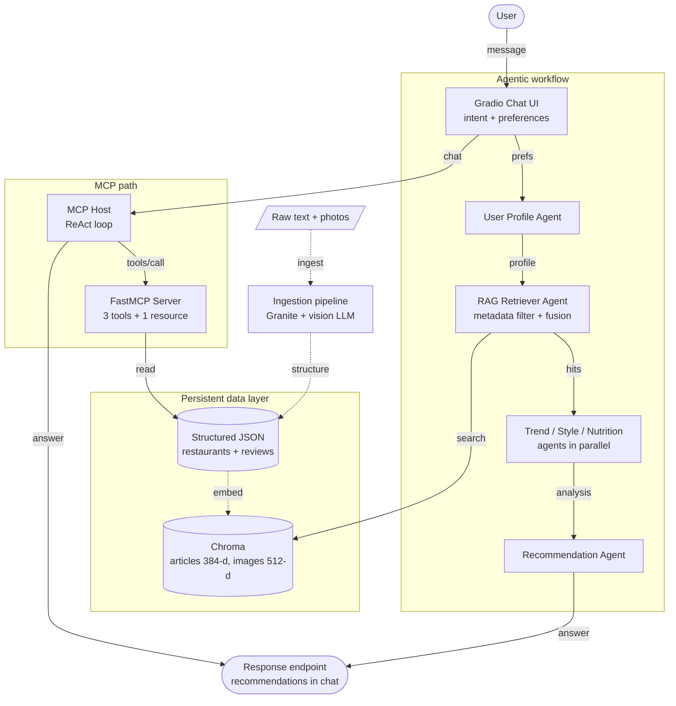

# 🍽️ Connoisseur Companion

**A multimodal RAG and multi-agent restaurant recommender for California dining, exposed through an MCP server and a Gradio chat interface.**

Ask for *"a moody spot in DTLA"* or *"zen dining in Little Tokyo"* and the system answers from real restaurant data: structured records, food photos and user reviews, instead of guessing from model memory.

> Capstone project for the **IBM RAG and Agentic AI Professional Certificate** (Coursera, IBM Skills Network).


<!-- Add a screenshot or GIF of the Gradio app here, e.g. docs/demo.png -->
<!--  -->

---

## Table of contents

- [What it does](#what-it-does)
- [Architecture](#architecture)
- [How it works](#how-it-works)
- [Tech stack](#tech-stack)
- [Repository structure](#repository-structure)
- [Getting started](#getting-started)
- [Usage](#usage)
- [Design notes](#design-notes)
- [Limitations](#limitations)
- [Acknowledgments](#acknowledgments)
- [Author](#author)

---

## What it does

| Capability | Description |
|---|---|
| **Structures messy data** | Turns free-text restaurant descriptions into validated JSON, and captions food and review photos with a vision model. |
| **Searches by meaning and by picture** | Text and images are embedded into separate vector indexes, filtered by metadata, and merged into one ranked list. |
| **Reasons with six specialist agents** | Profile, retrieval, trend, food style, nutrition and recommendation agents cooperate on every request. |
| **Calls tools over MCP** | A FastMCP server exposes restaurant lookup, vibe search and review retrieval. The host discovers them at runtime. |
| **Talks naturally** | A Gradio chat UI classifies intent, extracts preferences and returns formatted recommendations. |

---

## Architecture



Solid arrows are the online request path. Dashed arrows are the offline build that fills the database.

---

## How it works

### 1. Structure the data (Module 1)
- **IBM Granite** on watsonx.ai converts restaurant paragraphs into JSON.
- **Pydantic** validates every record, and an LLM auto-repair step fixes malformed output.
- A **LLaMA vision model** captions recipe images and review photos, using the review text as context, so images become searchable text.
- A **command-line manager** (`restaurant_data_management.py`) lets you browse, add, edit and delete records, with a confirmation step and an automatic `.bak` backup before every write.

### 2. Index and retrieve (Module 2)
- **Sentence-Transformers** (`all-MiniLM-L6-v2`, 384-d) embeds restaurant articles.
- **CLIP** (512-d) embeds food images.
- Both go into **Chroma** as two persistent collections: `restaurant_articles` and `food_images`.
- Retrieval is filter-first: metadata constraints (for example location or cuisine) narrow the pool, then cosine similarity ranks it.
- **Multimodal fusion** normalizes the text and image scores and blends them with tunable weights (`w_text`, `w_img`) into one ranking.

### 3. Add agents and a chat interface (Module 3)
Six agents, each with a role, goal and backstory:

1. **User Profile Generator** builds a profile from visit history and social posts.
2. **RAG Retriever** queries the vector databases.
3. **Food Trend Analyst**, 4. **Food Style Expert** and 5. **Nutrition Expert** analyze the candidates in parallel.
6. **Recommendation Expert** synthesizes everything into the final answer.

Workflow: *profile → retrieval → (trend ‖ style ‖ nutrition) → recommendation*, all sharing one state object. The Gradio chatbot classifies intent, extracts preferences, runs the workflow and formats the reply. It also has tabs for database management.

### 4. Expose tools through MCP (Module 4)
- **`server.py`** is a FastMCP server with one resource (the raw culinary map) and three tools: `get_restaurant_info`, `recommend_by_vibe` and `get_review`.
- **`client.py`** connects over stdio, declares **roots**, handles **sampling** requests, and calls every tool.
- **`app.py`** is the MCP host. It discovers tools at runtime, binds them to a watsonx Granite model and runs a **ReAct loop** (up to 10 iterations) until it can answer in plain text.

---

## Tech stack

| Layer | Tools |
|---|---|
| LLMs | IBM watsonx.ai (Granite, LLaMA vision), Anthropic Claude (MCP sampling), OpenAI models (agent notebooks) |
| Data validation | Pydantic |
| Embeddings | Sentence-Transformers (MiniLM), CLIP |
| Vector store | ChromaDB |
| Orchestration | LangChain, ReAct pattern, parallel agent execution |
| Protocol | Model Context Protocol via FastMCP |
| Interface | Gradio |

---

## Repository structure

Recommended layout. Adjust the paths to match your copy.

```text
connoisseur-companion/
├── 01-structure-data/
│   ├── M1L2-Process-Multimodal-Data-with-LLMs.ipynb   # vision captions + JSON augmentation
│   └── restaurant_data_management.py                  # CLI data manager + unit tests
├── 02-multimodal-retrieval/
│   ├── M2L1-multimodal-vector-index.ipynb             # Chroma indexes (text + image)
│   ├── M2L2-similarity-retrieval.ipynb                # top-k + metadata filtering
│   └── M2L3-fusion-ranking.ipynb                      # weighted multimodal fusion
├── 03-agents-and-chatbot/
│   ├── M3L1-Design-Specialized-Agents.ipynb           # six agents + tasks
│   ├── M3L2-Implement-Multi-Agent-Systems.ipynb       # hybrid sequential/parallel workflow
│   └── M3L3-Build-Chatbot-Interface.ipynb             # intent, preferences, Gradio
├── 04-mcp/
│   ├── server.py                                      # FastMCP server (resource + 3 tools)
│   ├── client.py                                      # client with roots + sampling
│   ├── app.py                                         # MCP host + ReAct loop + Gradio UI
│   ├── test.py                                        # smoke test for the server
│   ├── California-Culinary-Map.txt                    # data files must sit next to server.py
│   ├── structured-restaurant-data.json
│   └── augmented-user-review.json
├── docs/                                              # screenshots and architecture diagram
└── README.md
```

> `server.py` resolves its data files relative to its own folder, so keep the three data files in the same directory as `server.py`.

---

## Getting started

### Prerequisites
- Python 3.11 or newer
- An **IBM watsonx.ai** project (for Granite and the vision model)
- An **Anthropic API key** (only for `client.py` sampling)
- An **OpenAI API key** (only for the agent notebooks in Module 3)

### Installation

```bash
git clone https://github.com/abdelhady1000/<your-repo-name>.git
cd <your-repo-name>

python -m venv .venv
source .venv/bin/activate        # Windows: .venv\Scripts\activate
```

Install the MCP application dependencies (pinned as in the course labs):

```bash
pip install gradio==6.9.0 fastmcp==3.1.0 langchain-ibm==1.0.4 langchain-core==1.2.18
pip install mcp==1.25.0 anthropic==0.84.0
```

The notebooks install their own dependencies in their first cell (PyTorch, Sentence-Transformers, Chroma, LangChain and so on), so run those cells before the rest.

### Environment variables

| Variable | Used by | Purpose |
|---|---|---|
| `WATSONX_AI_PROJECT_ID` (or `WATSONX_PROJECT_ID`) | `app.py`, Module 1 notebooks | watsonx.ai project ID |
| `ANTHROPIC_API_KEY` | `client.py` | Claude calls for MCP sampling |
| `OPENAI_API_KEY` | Module 3 notebooks | Agent and chatbot LLM calls |

Never commit keys. Add a `.env` file to `.gitignore`.

### Data files

The datasets come from the IBM course environment and are not redistributed here unless the course license allows it. Download them from the course labs and place them as shown in [Repository structure](#repository-structure).

---

## Usage

**1. Check that the MCP server works**

```bash
cd 04-mcp
python test.py
```

You should see a JSON result for `get_restaurant_info("Iron")`.

**2. Run the MCP client demos**

```bash
python client.py
```

It prints a verification of discovered tools, resources and roots, then calls all three tools.

**3. Launch the full chat application**

```bash
gradio app.py
```

Open the printed local or public URL, then try:

- *"Find me some moody restaurants"*
- *"Tell me about Iron & Embers"*
- *"What's a zen dining experience in Little Tokyo?"*

**4. Manage the restaurant database from the terminal**

```bash
cd 01-structure-data
python restaurant_data_management.py
```

As shipped, this file runs the unit tests. Switch to the commented `manage_restaurants(FILEPATH, BACKUP_PATH)` line at the bottom to start the interactive menu.

---

## Design notes

- **Everything downstream inherits the quality of the structured JSON.** Validation and repair in Module 1 matter more than any later tuning.
- **Filter first, then rank.** Metadata constraints cut noise that similarity alone cannot remove.
- **Fusion weights are a product decision.** Text-heavy and image-heavy settings rank the same query differently.
- **Runtime tool discovery** means the MCP host does not change when the server gains a tool.
- **Credentials stay out of the code.** The host reads them from environment variables, and sampling keeps API keys on the client side.

---

## Limitations

- Built on a **course-provided, synthetic dataset**, so results are a demonstration of the pipeline, not a production recommender.
- The multi-agent notebooks use a **simplified workflow** with parallel threads rather than a full LangGraph deployment.
- Each MCP tool call opens a fresh server process, which is simple but not optimized for latency.
- The agents mix model providers (watsonx, OpenAI, Anthropic) because each lab targeted a different stack.
- No automated evaluation of recommendation quality yet.

### Ideas for next steps
- Persist one long-lived MCP session instead of one per call
- Add retrieval evaluation (hit rate, MRR) and compare fusion weights
- Unify on a single LLM provider behind one configuration file
- Containerize with Docker

---

## Acknowledgments

Built as the capstone of the **IBM RAG and Agentic AI Professional Certificate** on Coursera, using lab material from IBM Skills Network. Lab content and datasets belong to their respective authors.

---

## Author

**Mohamed Abdelhady Kasiem**
CS student at Nile University, building RAG and agentic AI systems.
GitHub: [@abdelhady1000](https://github.com/abdelhady1000)

## License

Add a license (for example MIT) for your own code, and keep the course material's terms in mind for the datasets.
